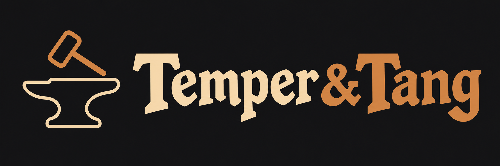
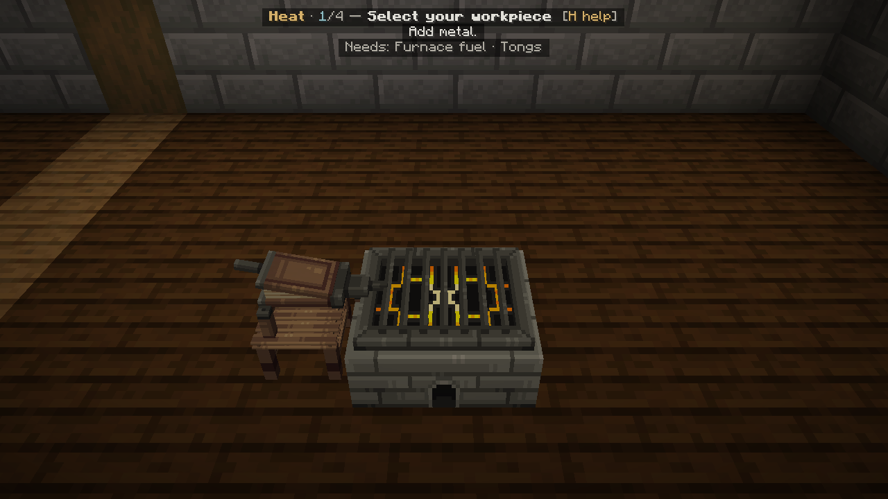
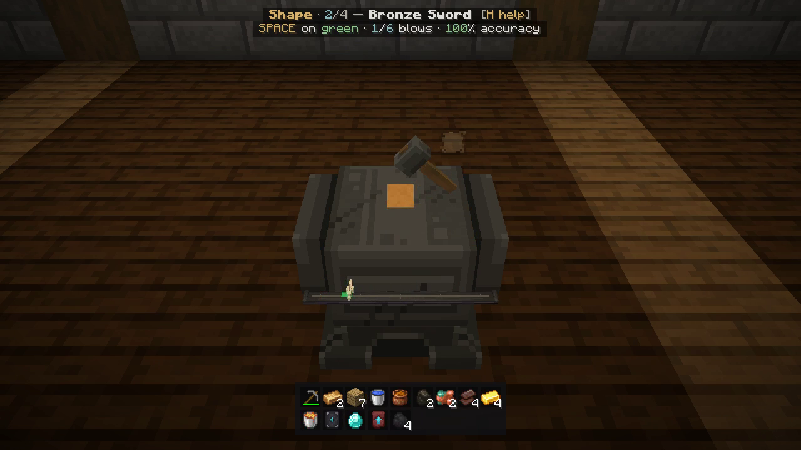
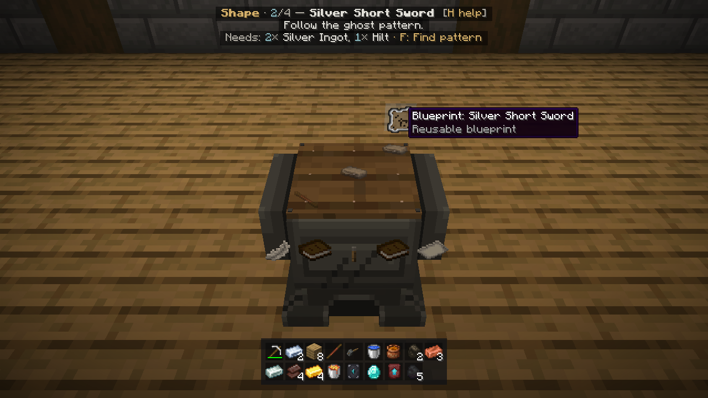
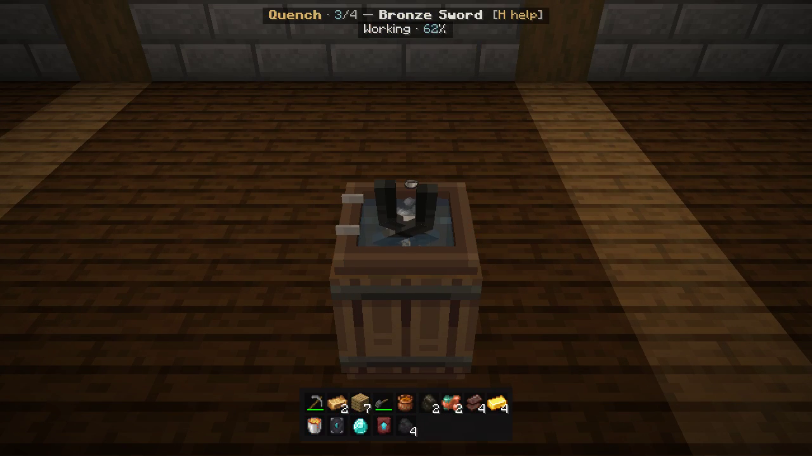
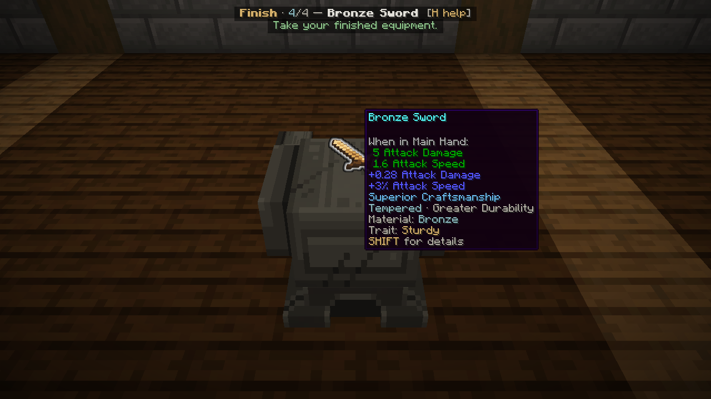
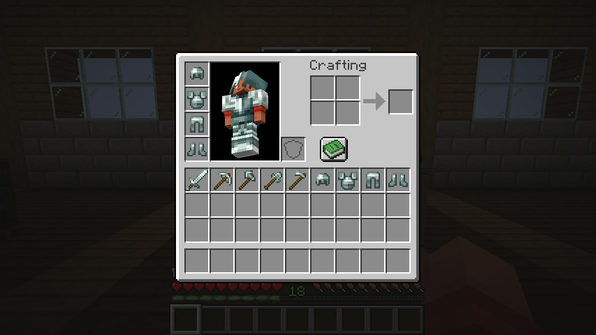
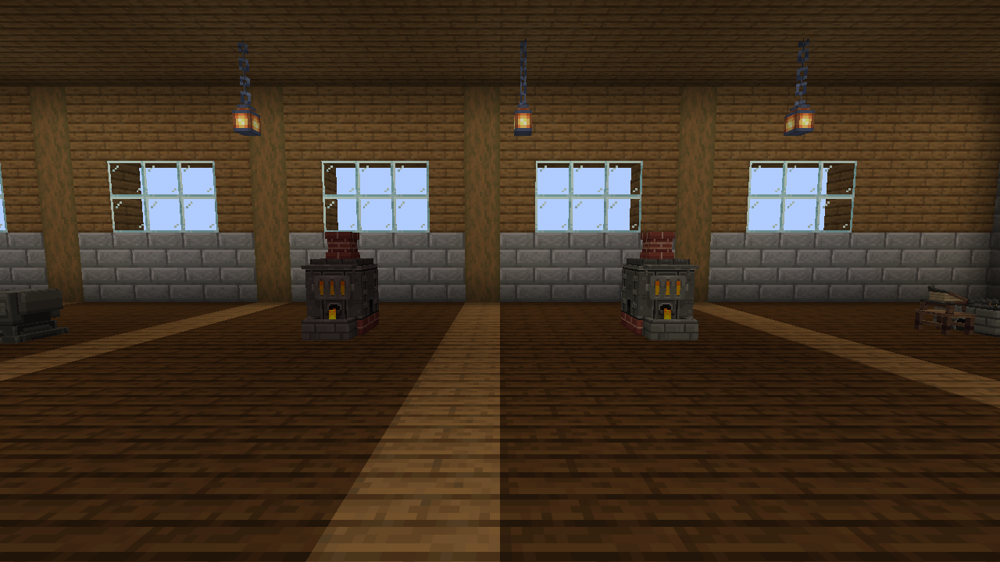

**Work the metal. Make it yours.**

[Getting started](docs/THERMAL_WORKSHOP.md) · [Metals and progression](docs/METALLURGY.md) · [Configuration](docs/CONFIGURATION.md) · [Report an issue](https://github.com/BareMinimumStudios/temper-and-tang/issues)

## A place at the anvil

Temper & Tang brings the work of a blacksmith into the world. Stoke the hearth, lay hot metal on the anvil, strike to the rhythm, then lower the shaped workpiece into water. Finish the cooled equipment to suit the way you use it.

A good weapon begins with good work. Strike accuracy, material and smithing experience influence its craftsmanship. Luck still plays a part, but a masterwork takes practice. Rough equipment remains usable, and enchantments can add something extra afterward.

For **Minecraft 1.21.1**, on **Fabric and NeoForge**. Install it on the server and every client.

## Heat, shape, quench, finish

### Stoke the hearth

Refine raw metal or bring ingots back to working heat. The bellows feed the coals as the stock warms. Hold tongs in either hand when moving hot metal.

### Make each strike count

Find a pattern with **F**, check its ingredients, and lay them out on the anvil. Keep your cursor empty, then press **Space** as the marker reaches the green band. Tougher materials have tighter timing and can ask for several strikes in a phrase.

### Keep the pattern

Some advanced equipment needs a matching blueprint. Choose the pattern, insert a blank blueprint and press **B** once you have the required mastery. The finished blueprint is reusable.

### Take the workpiece to water

The result of shaping is an **Unquenched Workpiece**, not a usable weapon. It carries the equipment you are making and the quality you earned. Take it with tongs, add water to the barrel, and quench it. If it cools before you get there, reheat it at the hearth.

### Give it a finish

Bring the cooled equipment, hammer and a finishing material to the finishing anvil. Choose durability, a sharper edge, heavier blows or quicker handling. Most finishes cost two experience levels. Better timing strengthens the treatment; a new finish replaces the old one.

## Choose your metal

Tin, bronze and steel each have a sword, four tools and a full armor set. Tin keeps a pale silver-white finish, bronze has warm coppery tones, and steel is darker and stronger.

Silver has its own ore, raw metal, ingots, nuggets and storage blocks. Its cool color stands apart from tin. Common material tags let compatible equipment recipes use it directly.

The main route is **copper + tin → bronze → iron → steel → diamond → netherite**. Alloy copper and tin for bronze, then iron and coal or charcoal for steel. Diamond gear comes from upgrading steel at a smithing table with a structure-found template. The Nether alloy forge combines gold and scrap into netherite and can also run ordinary alloys.

Ore appears in newly generated Overworld chunks. See the [metallurgy guide](docs/METALLURGY.md) for recipes, mining requirements and the full route.

## Five grades of craftsmanship

**Rough · Serviceable · Fine · Superior · Masterwork**

Quality affects durability and the stats that matter to the equipment: damage and handling for weapons, protection for armor, mining speed for tools. The tooltip keeps the grade, finish, material and trait together. Hold **Shift** for the details and maker's mark.

## Install

Use Java 21 and the build for your loader. Both sides need Temper & Tang and its required libraries:

| Both loaders | Fabric also needs | NeoForge also needs |
| --- | --- | --- |
| Diegesis 1.0.0-beta.19 and a matching 1.21.1 build of Fzzy Config | Fabric API and Fabric Language Kotlin | Kotlin for Forge |

Required libraries are installed separately. Optional equipment and recipe-viewer integrations do not need extra companion addons. Check the [installation guide](docs/INSTALLATION.md) for the tested versions.

## Make it fit your pack

Tune timing, mastery, quality, finishing and hot-metal handling in `config/temperandtang/config.json5`. Recipe costs and accepted materials can be changed with datapacks. Common `c:` tags cover metals, ores, tools and armor; workshop tags cover blueprints, finishing materials and stations.

[Configuration](docs/CONFIGURATION.md) · [Datapack and API guide](docs/API.md) · [Compatibility](docs/COMPATIBILITY.md)

## Project

[Source](https://github.com/BareMinimumStudios/temper-and-tang) · [Issues](https://github.com/BareMinimumStudios/temper-and-tang/issues) · [Documentation](docs/README.md) · [Development](DEVELOPMENT.md) · [Changelog](CHANGELOG.md)

[Modrinth page copy](docs/MODRINTH.md) · [CurseForge page copy](docs/CURSEFORGE.md)

The project uses the [Bare Minimum License](LICENSE). Supplied artwork is credited in [Third-party notices](THIRD_PARTY_NOTICES.txt).
