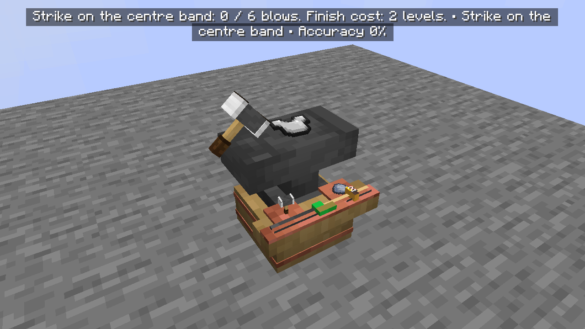

# Temper & Tang

Standalone, material-driven medieval smithing for **Minecraft 1.21.1**, written in Kotlin for **Fabric and NeoForge**. A Bare Minimum Studios project.

The first revision uses **Diegesis charcoal heating, scored hammer work, water quenching and equipment finishing**. Place materials directly on physical workstations, work the metal, then retrieve the result. Its rules and item consumption run on the server. Fzzy Config supplies the configuration interface, validation and synchronization.

## Current features

- Standalone heat → shape → quench → finish progression, including metal armor, tools, shields and weapons.
- Six server-rolled craftsmanship grades, weighted toward strike accuracy, with a smaller random contribution and smithing mastery bonus.
- Player mastery, maker records, reusable advanced blueprints and paid hot-gear reforging with smithing flux.
- Optional Simply Swords, Simply More and Epic Knights support using their original item identities and authored recipes.
- Tin ore and raw tin; copper/tin bronze blending; additive common material and tool tags.
- Owned Smithing Tongs, bounded contact burns and wear, automatic inventory/cursor cooling and unusable unquenched workpieces.
- Directional workstations, contextual slots, physical hammer controls, a changing timing gauge, tiny sparks, varied anvil sounds, water and embers.
- Tempered, Keen, Weighted and Lightened finishes. Precision controls the smaller finish bonus. Armor accepts Tempered or Lightened.
- Preserved names, enchantments, damage and foreign custom data, including netherite upgrades. Reprocessing replaces bonuses rather than stacking them or repairing gear for free.

## Playing

Install the correct loader JAR, Fzzy Config, Diegesis **beta.17** for your loader, and Fabric Language Kotlin or Kotlin for Forge. See `libraries.toml` for exact development dependency pins. Simply Swords, Simply More and Epic Knights are optional equipment integrations. Overgeared is not required or used. The workshop handles weapons, tools, shields and metal armor with server-owned craftsmanship, mastery and reusable blueprints.

Follow the [thermal workshop guide](docs/THERMAL_WORKSHOP.md) to heat refined stock, shape equipment, quench it, learn blueprints and reforge existing gear.

Craft the Finishing Anvil, hammer and a finishing material. Place one supported equipment item, the material and hammer in their physical slots. Keep the cursor empty, then click the working hammer or press **Space** as the timing marker crosses the central band. Timing varies between blows. The first strike starts the challenge; preparation time is free. Most finishes require six blows and two experience levels. The final accepted blow commits the result and costs once. Closing returns session-owned inputs and completed work.

The table shows full-precision finishing bonuses; lower precision reduces their strength. Craftsmanship is a separate, larger equipment-quality layer.

| Finish | Default benefit | Tradeoff |
| --- | --- | --- |
| Tempered | +15% maximum durability | Material, work and XP |
| Keen | +5% attack damage | -10% maximum durability |
| Weighted | +10% attack damage | -5% attack speed |
| Lightened | Weapons: +5% attack speed; armor: +1% movement per piece | -10% maximum durability |

The config is `config/temperandtang/config.json5`. Server settings govern results. Reload datapacks after changing recipe integration settings. These finishes do not enable Simply Swords implicits or add armor-piercing effects.

The finishing anvil is crafted with a vanilla anvil, two copper ingots and three planks. Craft the finishing materials in the normal grid; their tooltips list the effects. Both coal and charcoal work for tempering compound. Hold Smithing Tongs in either hand when moving heated stock. Shape and quench a workpiece before applying a finish.



## Development

Use Java 21 and the checked-in **Gradle 9.9.2** wrapper:

```powershell
./scripts/build.ps1 -Clean
```

```sh
scripts/build.sh
```

The build creates separate Fabric and NeoForge JARs. Verified files, checksums, license notices and release notes are staged in `build/release/`. Nothing is uploaded automatically. GitHub workflows build both targets and can prepare an explicitly requested draft release. Modrinth publishing can be configured when project pages exist.

## Scope

This is a tested first revision. Further alloy traits, runes and additional original weapon forms remain future work. Live station sessions return items when closed rather than keeping persistent block inventories. Working heat uses world ticks. Workstation and tool geometry is original and references Minecraft textures; several material icons use vanilla texture shapes. Tin generates only in new chunks. See the verification record for tested coverage and remaining multiplayer, latency and balance playtesting.

See [design](docs/DESIGN.md), [compatibility](docs/COMPATIBILITY.md), [development](DEVELOPMENT.md) and [release checklist](docs/RELEASING.md), [public API](docs/API.md) and [verification record](docs/VERIFICATION.md).

## License

The Bare Minimum License v1.0 applies to this project. See `LICENSE` and `THIRD_PARTY_NOTICES.txt`. External mods retain their own licenses and are not bundled.
