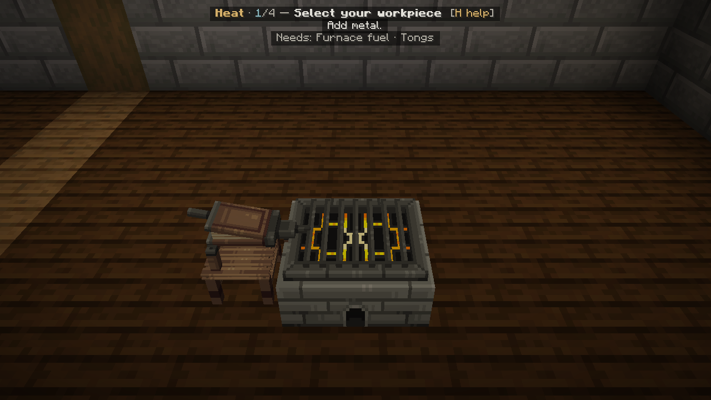
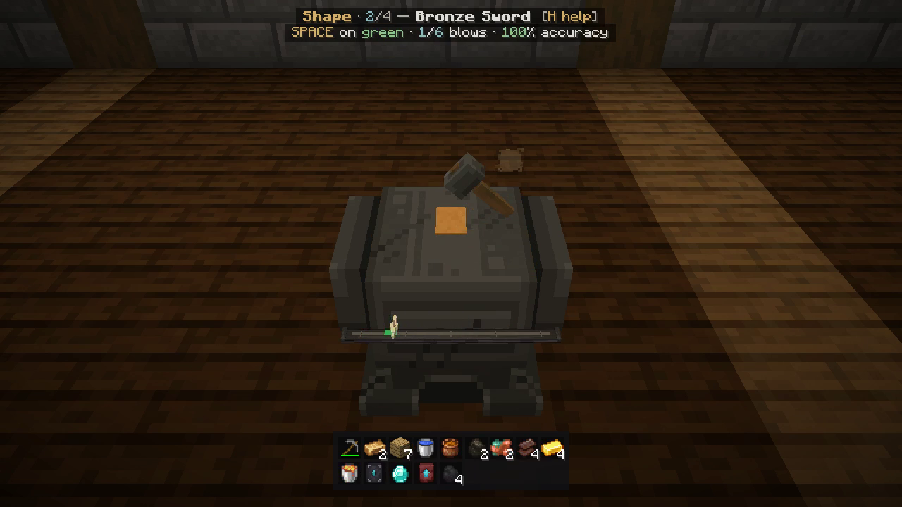
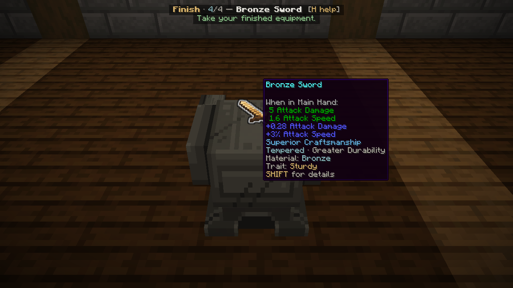
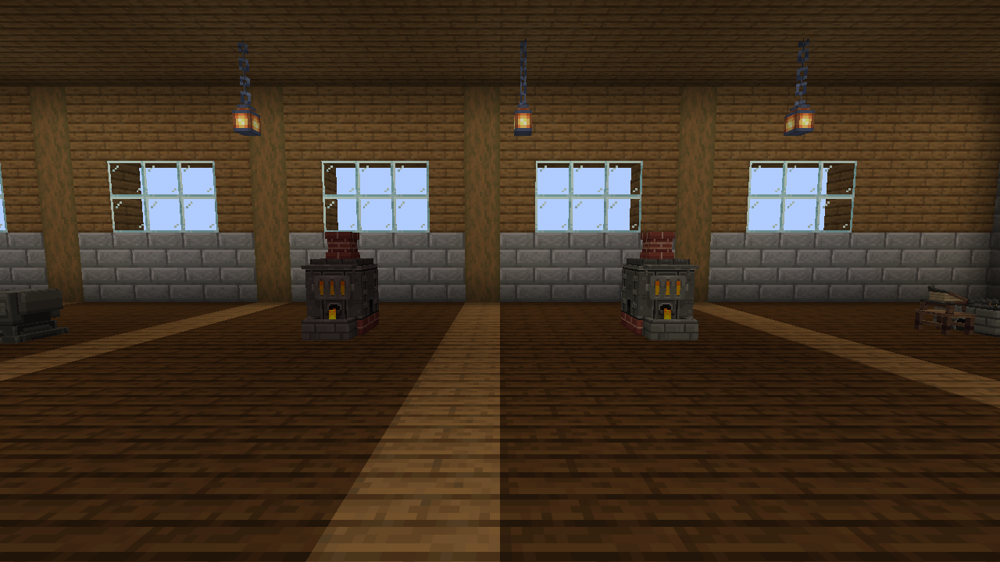
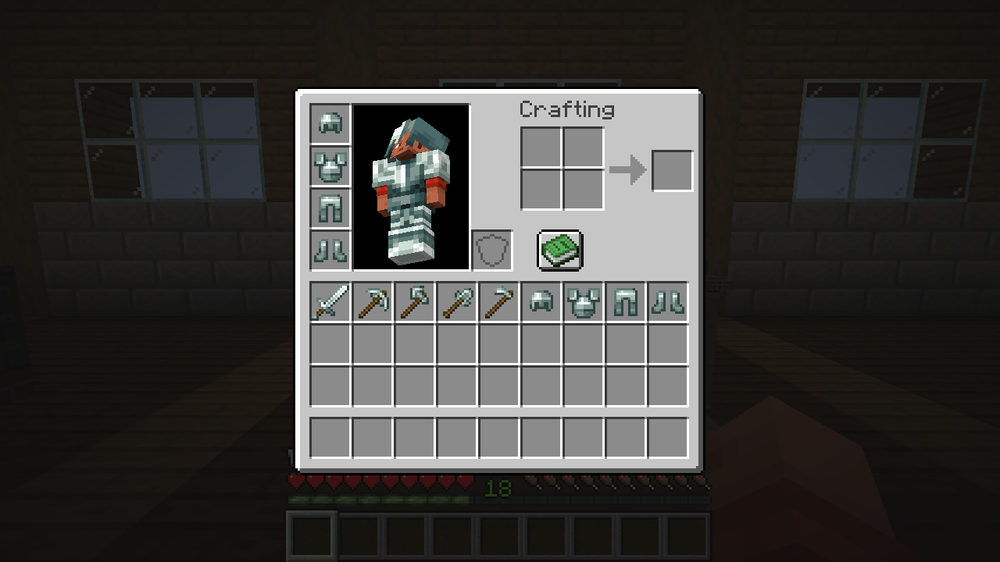

Build a workshop, bring the hearth to life, and make equipment with your own hands. Temper & Tang takes metal through heating, shaping, quenching and finishing, with the work laid out on the stations in front of you.

For **Minecraft 1.21.1 · Fabric and NeoForge · Client and server**.

## At the hearth

Refine raw metal or heat your ingots, work the bellows, and carry hot stock with tongs.

## At the anvil

Search for a pattern, lay out its ingredients, and time your hammer blows as the marker crosses the green band. Some materials are forgiving; others need a steadier hand. Advanced patterns use reusable blueprints.

## Into the water

Take the shaped workpiece to the quenching barrel. It becomes usable equipment only after quenching, carrying the craftsmanship you earned at the anvil.

## The finishing touches

Temper it for durability, hone it for a sharper edge, add weight for harder hits, or lighten it for quicker handling. Craftsmanship ranges from Rough through Serviceable, Fine, and Superior to Masterwork. Strike accuracy matters most, with smaller contributions from mastery and luck. Tool quality affects mining speed and durability. Weapon quality affects damage and handling.

## A workshop that grows with you

Tin, bronze and steel each have a sword, tools and a full set of armor. Tin is a soft early option. Bronze unlocks iron mining, and the Alloy Forge makes bronze from copper and tin and steel from iron and coal or charcoal.

Find a Diamond Upgrade Smithing Template in a structure chest, then upgrade steel gear with a diamond at the smithing table. The Nether Alloy Forge makes netherite ingots from gold ingots and netherite scraps. Upgrade diamond gear with the ingot and a Netherite Upgrade Smithing Template.

Silver has its own ore and works with compatible equipment recipes, including supported Epic Knights patterns.

## Armor belongs at the anvil too

Forge helmets, chestplates, leggings and boots through the same workshop stages. Armor takes extra strikes; craftsmanship affects durability, protection and existing toughness. Temper it for durability or lighten it for movement at a durability cost.

Optional Simply Swords and Simply More support covers ordinary weapons. Epic Knights equipment uses its native patterns and a matching reusable blueprint. Unique and legendary weapons stay outside the normal forging route. Supported smithing upgrades preserve craftsmanship and finishing.

## Getting started

Install the matching build on the server and every client. Both loaders need **Diegesis 1.0.0-beta.19** and **Fzzy Config**. Fabric also needs **Fabric API** and **Fabric Language Kotlin**; NeoForge needs **Kotlin for Forge**. Use **Java 21**.

Start with copper and tin. Smelt them, combine three copper ingots and one tin ingot into bronze blend, then smelt the blend. Bronze gets your first hammer and shaping anvil under way. EMI and JEI show station recipes, blueprints and upgrades. Refining and alloying have animated progress previews.

At a station, **H** opens help. **F** finds a shaping pattern, **Space** works the station, **B** scribes a blueprint, and **Shift** expands equipment details. Keep the cursor empty while striking.

## For your modpack

Common material tags and datapack recipes make it easy to fit the workshop around your pack. Timing, quality, mastery and finishes are configurable. Tin veins start from Y 20 to 80 and peak near Y 50. Silver veins start from Y −16 to 30 and are most common around Y −1 to 15. Both generate in new Overworld chunks and can be disabled separately. Equipment keeps its name, enchantments and wear as it moves through the workshop and its upgrades.

[Player guide](https://github.com/BareMinimumStudios/temper-and-tang/blob/main/docs/THERMAL_WORKSHOP.md) · [Source](https://github.com/BareMinimumStudios/temper-and-tang) · [Report an issue](https://github.com/BareMinimumStudios/temper-and-tang/issues)
