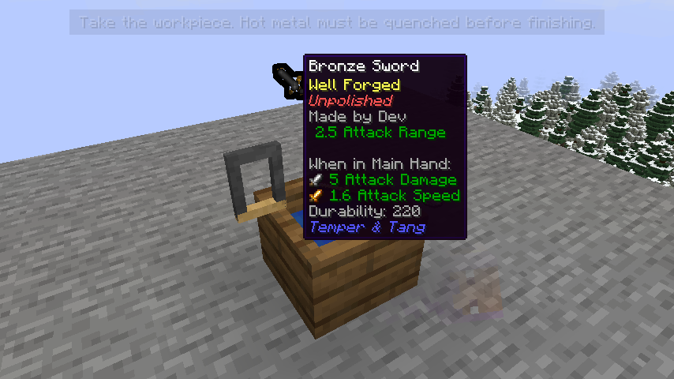

# Thermal workshop guide

## Make the workstations

- **Charcoal Hearth:** seven cobblestone around coal or charcoal (leave the top-middle empty).
- **Shaping Anvil:** three bronze ingots above one smooth stone and three planks.
- **Quenching Trough:** five planks in a boat shape, with two sticks beneath its corners.
- **Smithing Hammer:** use the normal recipe shown by your recipe viewer. Native Overgeared hammers also work; tier restrictions apply when its server enables them.

The stations support survival play on both Fabric and NeoForge 1.21.1. Diegesis and Fzzy Config are required. Overgeared and Simply Swords remain optional.

## Heat → shape → quench → finish

1. Put up to eight refined ingots in the hearth's stock slot, and coal or charcoal in its fuel slot. Click the bellows or press **Space** with an empty cursor. Each item takes five seconds by default; a native heating recipe may require longer. One coal pays for up to 1,600 heating ticks. Fuel is spent immediately.
2. Retrieve the hot stock. Its tooltip shows the remaining working heat. Work within about **60 seconds** by default, or reheat. With Overgeared installed, use its tongs and hot-item handling rules.
3. Open the shaping anvil. The ghost pattern shows the selected weapon. Click the book controls or press **Left/Right** to change patterns. Place heated metal and the other ingredients in the shown 3×3 arrangement, then insert a smithing hammer.
4. Click the working hammer or press **Space** on the bright beat. The default rhythm is one beat per second, with at least six blows. Native recipes may need more. Repeated packets/clicks in the same beat cannot speed this up. Accurate work can earn **Well** quality; basic work cannot award Expert, Perfect or Master.
5. Take the hot shaped weapon to the trough, add a water bucket, then click the tongs or press **Space**. Quenching takes two seconds and consumes the water, leaving an empty bucket. Retrieve both items. Standalone unquenched workpieces become their usable weapon only here.
6. Complete native polishing where required. Apply the existing optional finish at the finishing anvil using one finishing material, paced strikes and experience. Hot and unquenched workpieces are refused there.

## Overgeared integration

The browser reads actual loaded forging recipes after pack overrides. It supports compatible basic bronze, iron and gold swords/Simply Swords weapons at stone tier. Blueprints, higher anvil tiers, minigame-only recipes, ingredient-data transfers and advanced quality requirements remain native Overgeared work. A recipe absent from this browser may still be available through its native station.

Native recipe patterns, hot-iron variants, ingredient-quality caps, tiered-hammer settings, author, polish state and quality components are respected. The new hearth heats refined stock; it does not replace ore smelting or higher-tier material production. Existing native quenching/cooling routes still function. Native air-cooling behavior is retained; the new shaping station does not rewrite unrelated Overgeared progression.

Without Overgeared, basic iron/gold/bronze shaped weapon recipes move to the shaping station. Ordinary shaped crafting cannot bypass it. The shaped result is a non-weapon unquenched workpiece, protecting the quenching step from ordinary repair crafting.

## Closing, cooling and saving

- Closing returns all owned inputs, tools, buckets, and any completed workpiece through Diegesis. Keep inventory space available; its normal overflow handling applies.
- Closing unfinished shaping loses its strike progress, while ingredients and hammer durability are retained. The final blow consumes ingredients and hammer wear immediately and commits the actual workpiece; closing cannot reroll it for free.
- Heating fuel and quenching water already used are not refunded by cancelling. Reopening starts a new process.
- Hot stock and encoded standalone workpieces survive item save/reload. Their heat expires as world time advances. Native quality, names, enchantments, damage and foreign component data survive cooling.
- These are session workstations, not unattended machines with persistent block inventories. Close them before leaving.

## Server settings and pack support

`config/temperandtang/config.json5` exposes thermal enablement, heating duration, working-heat duration, blows, beat duration/window and quenching duration through Fzzy Config. Native Overgeared cooldown is an upper bound. Disable thermal shaping and reload datapacks to restore standalone ordinary crafting recipes. Existing optional native recipe integration has its own toggle.

Refined stock uses additive `temperandtang:heatable_stock`, populated by optional common `c:ingots/iron`, `/gold`, `/copper`, `/tin`, `/bronze` tags. Other packs can extend the tag. The thermal wrapper recipe serializer/type is `temperandtang:shaping`, with vanilla shaped-recipe fields; native mode reads `overgeared:forging` instead.

Operators can run `/temperandtang verify`, `/temperandtang verify_station` and `/temperandtang verify_thermal`. The thermal diagnostic uses isolated inventories on real server ticks and takes about a minute with default settings.

## Workstations in the tested client

