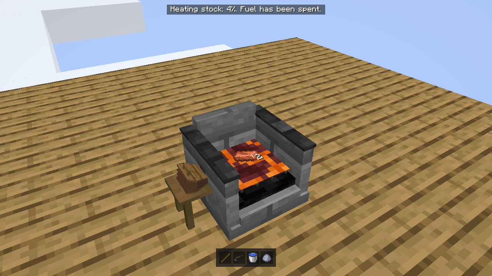
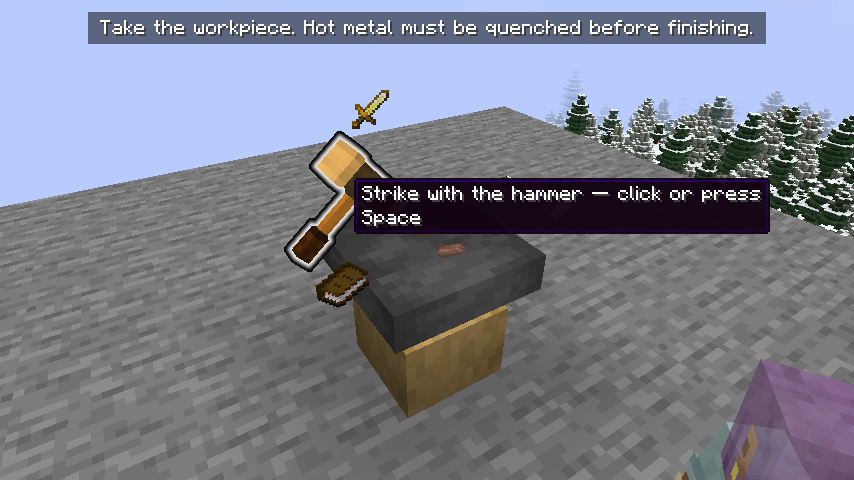

# Standalone thermal workshop guide

Temper & Tang supplies its own tools, heat, shaping and quenching. It requires Diegesis, Fzzy Config and your loader's Kotlin runtime. It does not require Overgeared.

## Make the tools and workstations

- **Smithing Tongs:** two iron nuggets in the top corners, two iron ingots beneath them, and a stick in the bottom centre. Common iron and wooden-rod tags work. Repair the tongs with an iron ingot at a vanilla anvil.
- **Smithing Hammer:** the normal bronze-and-stick recipe shown in your recipe viewer.
- **Charcoal Hearth:** seven cobblestone around coal or charcoal; leave the top-middle space empty.
- **Shaping Anvil:** three bronze ingots above one smooth stone and three planks.
- **Quenching Trough:** five planks in a boat shape with two sticks beneath its corners.

## Heat → shape → quench → finish

1. Hold **Smithing Tongs in your offhand**. Either hand protects you, but the offhand leaves your cursor free to operate the stations.
2. Put up to eight refined ingots and enough coal or charcoal into the hearth. Click the bellows or press **Space** with an empty cursor. Default heating is five seconds per item. A coal pays for up to 1,600 heating ticks; fuel is spent when work starts.
3. Retrieve the hot stock. It has about **60 seconds** of working heat by default. Its tooltip shows the remaining time. Reheat if it cools before shaping.
4. Open the shaping anvil. The ghost pattern shows the selected weapon. Click the book controls or press **Left/Right** to change patterns. Put heated metal and the remaining ingredients in the shown 3×3 arrangement, then insert the hammer.
5. Click the hammer or press **Space** for each blow. The bright beat helps you pace the work; the default is one beat per second and six blows. Extra clicks in the same beat cannot accelerate it. Standalone shaping currently has no quality-grade bonuses.
6. The final blow commits an **Unquenched Workpiece**. It is not yet a usable weapon. Carry it to the trough with your tongs, add a water bucket, then click the trough tongs or press **Space**. Default quenching takes two seconds, consumes the water and leaves an empty bucket.
7. Retrieve the usable cooled weapon and empty bucket. You may now finish the weapon at the finishing anvil using a finishing material, paced blows and experience.

The tongs shown at the trough are its control. Your handheld Smithing Tongs protect you while moving hot stock between workstations.

## Hot-metal handling

Without held tongs, carrying hot stock deals **half a heart every two seconds** by default. This is contact damage, not persistent fire. Cursor-held hot stock also counts. Multiple stacks do not multiply damage or tool wear.

Held tongs take one durability when first handling stock, then at most one per **ten seconds of hot handling**, regardless of stack count. They have 256 durability, can be repaired, and do not wear while carrying only cold items. One tool lasts roughly 42 minutes of active hot handling at the default rate. Creative/spectator players are exempt; Fire Resistance prevents burns.

Hot stock automatically becomes cold in your inventory or on your cursor when its working heat expires. Chest and dropped-item heat also expires with world time; moving it back into your inventory normalizes its saved state. A cold unquenched workpiece stays unusable: reheat it, then quench it. Air cooling cannot skip that step.

## Closing and saving

- Closing returns owned inputs, tools, buckets and completed workpieces through Diegesis. Keep inventory space available; its normal overflow handling applies.
- Partial shaping loses progress without consuming materials or hammer wear. The final blow consumes both and commits the workpiece, so closing cannot reroll it for free.
- Fuel and water already spent are not refunded by cancelling.
- Working heat, encoded workpieces, worn tongs, names and foreign item data survive saving and reloading.
- Workstations use session inventories rather than unattended persistent block storage. Close them before leaving.

## Settings and compatibility

`config/temperandtang/config.json5` exposes heating/cooling time, shaping rhythm, quenching time, contact damage/interval, handling enablement and tongs wear through Fzzy Config. Server values govern gameplay. Turning off contact handling still allows existing stock to cool. Disabling thermal shaping and reloading restores ordinary standalone shaped recipes.

Other tool authors can add tongs to `c:tools/tongs` or `temperandtang:tongs`. Refined stock uses additive `temperandtang:heatable_stock`, populated by common iron, gold, copper, tin and bronze ingot tags. `temperandtang:shaping` uses vanilla shaped-recipe fields and is independent of another smithing mod.

Simply Swords basic iron/gold recipes work out of the box; Simply Swords and Simply More weapons also support finishing. A legacy Overgeared recipe bridge remains optional and disabled by default. Its external quality/polishing rules apply only when that bridge is deliberately enabled; they are not part of the standalone progression.

Operators can run `/temperandtang verify`, `/temperandtang verify_station` and `/temperandtang verify_thermal`. The first includes isolated tongs, cooling and burn checks; the thermal scenarios take about a minute with default settings.

## Workstations

